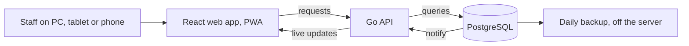

# Manufacturing System: Implementation Plan

Last updated: 2026-10-19. Built from [process.md](process.md), which is the source of truth for how the factory works.

## Summary

We build one modular application, a Go API with a PostgreSQL database and a React web app, in seven milestones. The live floor board comes early, because it is what the owner will see first. This plan turns the confirmed process document into a build order.

| Layer | Choice | Why |
| --- | --- | --- |
| Backend | Go, with the chi router, pgx, sqlc and goose migrations | One small binary, fast, easy to deploy, handles many live connections well |
| Database | PostgreSQL | Strong transactions for stock and reservations, plus LISTEN/NOTIFY for live updates |
| Frontend | React with TypeScript (Vite), Tailwind CSS with accessible component primitives, TanStack Query, i18next for English and Amharic, installable as a PWA | Fast to make look polished; works on any device with a browser; the PWA lets floor screens keep entries when the connection drops |
| Live updates | Server-Sent Events fed by PostgreSQL notifications | Simpler than WebSockets, and enough for a live board |
| API contract | OpenAPI spec, with TypeScript types generated from it | Go and React cannot drift apart on field names or types |

**One trade-off to know.** TypeScript on the backend would let one language cover everything. Go costs a little extra on the frontend types (handled by the generated spec) and gives a sturdier, faster backend for an event-heavy system. Both are sound, and we are going with Go as chosen.

**Principles that shape every part**
- Stock, output and reports are *derived* from an append-only record of events and stock movements, never from numbers someone typed over.
- Business rules (reserve partial stock, first order first, alert thresholds, shift times, units) live in settings in the database, not in code.
- Every override needs a reason where the process says so, and is written to an audit log.
- Times are stored in UTC and shown in the Ethiopian calendar by default, with Gregorian as an option.
- Company-specific things (products, colors, machines, shifts) are data. Crown is the only company for now, but a second one later should need configuration and a company field, not a rewrite.
- The interface is a product in its own right. The first impression decides whether people trust the system, so it is designed before it is built and held to a high standard on every device (see Interface quality). Correct business logic is what keeps that trust, so both get the same care.

## Architecture

The system is one deployable application, not a set of separate services. A single Go API holds every rule, so the React app and the database never talk to each other directly.



The app sends requests to the API. When something changes on the floor, the database notifies the API, which pushes the update to every open screen, so the live board refreshes without anyone reloading. Inside the Go API the code is split into modules (inventory, production, sales and so on) that match the process document, which keeps a later split into separate services possible if it is ever needed.

## Data model

The database has eight groups of tables. The ones that record what happened are append-only, so history can always be replayed.

| Group | Core tables | What they hold |
| --- | --- | --- |
| Settings and audit | settings, audit_log | Every configurable rule; who changed what, when, and why |
| Master data | products, product_variants (color), items, units, boms and bom_lines, workspaces, damage_reasons, locations | What Crown makes and with what: unit per product, package size, cycle time, cavities, regrind rules per BOM line (allowed, source products, maximum blend), the five stock locations |
| Inventory | lots, stock_movements, reservations | Every move of material between locations; reservations tied to an order line or production order with a priority |
| Purchasing | purchase_orders, purchase_order_lines, goods_receipts | Draft and approved purchase orders, partial arrivals; an editable expected arrival date (ETA) per line, with the order's expected arrival shown on the order and in the purchasing view |
| Sales | receipts, orders, order_lines, deliveries, sample_requests | Receipt number and quantity only; ordered, paid and delivered per line; sample and pay-later releases |
| Production | production_orders, plans (versioned), daily_plans, material_requests, floor_events, qc_records, staging_batches, recycle_runs | The whole run from plan to finished goods and regrind |
| People | employees, roles, user_accounts, shifts, rosters, assignments, attendance, handover_reports | Who works when and where, with every move timed |
| Reporting | views and scheduled snapshots | Weekly report, reconciliation, performance, built from the tables above |

**Rules the database itself enforces**
- Floor events, stock movements and audit rows are never edited or deleted. A mistake is fixed by a new reversing entry with a reason.
- Available stock is calculated as on-hand minus reserved, so the two states can never disagree.
- Every delivery row must point to a receipt, a sample request or a pay-later record. A release with none of these is rejected.
- Every floor event carries the user who entered it, the employee it concerns (operators have no accounts), workspace, shift, time and a client-generated key, so an entry sent twice after an offline sync is stored once.
- Every quantity has a unit, taken from the product, so kg and pieces are never mixed silently.

## Logic to get right

These six rules carry the most risk, so each gets its own tests before screens are built on top of it.

**1. Reservation and the order chain.** A receipt creates an order. In one database transaction the system locks the stock rows, reserves the available part first-order-first, creates a production order for the shortfall, checks the BOM, reserves raw material, and drafts a purchase order if material is short. Two cashiers selling the last stock at once must never both succeed, which is why row locking is used. When material or finished goods arrive, the same allocation runs again for waiting orders in priority order, which authorized users can change.

**2. Plans from cycle time.** The default plan uses the formula that Crown's weekly report already follows:

```latex
\text{target (pieces)} = \frac{\text{planned hours} \times 3600}{\text{cycle time (s)}} \times \text{cavities}
```

The production manager can edit any plan. Each edit creates a new plan version with a reason, and the old version stays visible.

**3. Recycling and yield.** Material balance for each run is virgin plus regrind loaded equals good output plus damaged output, in kg. Damaged output goes through the recycling workspace and comes back as regrind with no loss, so the same kilogram is never counted as new virgin material. Two figures are reported and always labelled:

```latex
\text{net yield} = \frac{\text{good output (kg)}}{\text{virgin material consumed (kg)}}
```

Gross throughput is everything that passed through a machine, regrind included, and is used for productivity. Whether a product may use regrind, and how much, is set on its BOM (Crown: egg trays yes, jar covers no).

**4. Paid versus delivered.** Paid and delivered quantities live on each order line and are never merged. A later delivery of a carried-over balance points back to its original receipt. Samples and pay-later releases are their own delivery types, so the finance reconciliation lists them separately instead of as unexplained stock leaving.

**5. Events and the live board.** The board is a projection of floor events: a machine's status is whatever its latest event says. New events reach open screens through Server-Sent Events. Offline screens keep entries in the browser and send them with their keys when the connection returns, so power cuts do not lose data.

**6. Shifts and dates.** A shift that crosses midnight belongs to the day it started. Weeks, months and reports follow the Ethiopian calendar (13 months), through one tested conversion module used by both the API and the screens. The handover report stores both the reported and the weighed quantity, and flags any difference.

## Build phases

The production floor (milestone 4) is built before the sales chain, because that is where Crown loses the most visibility today. Until milestone 6, production orders are created by hand, which is also how Crown fills its finished goods store.

1. **Foundation:** login and roles, audit log, settings, design system, English and Amharic text, Ethiopian calendar module, database, automated tests.
2. **Master data:** first a small PR that saves each person's language and calendar choice on the server (the device value stays as the fallback before sign-in); then products and colors, BOMs, machines, shifts, employees, damage reasons, stores, and the administrator screen for settings.
3. **Inventory and purchasing:** lots, stock ledger, reservations, purchase orders, receiving, regrind store.
4. **Production floor:** orders, plans, material requests, machine events, QC, staging, recycling, handover, offline entry.
5. **Live board and reports:** floor board, owner dashboard, alerts, automatic weekly report.
6. **Sales and finance:** receipt to order chain, pay-later, samples, deliveries, reconciliation report.
7. **People and rollout:** rosters and rotation, attendance, performance, factory pilot, training.

From milestone 2 on, screens are mocked up and approved before they are built. Each milestone ends with something you can use and check:

| Milestone | Done when |
| --- | --- |
| 1. Foundation | A user can sign in, roles limit what they see, the Ethiopian and Gregorian date conversion passes its tests, changes appear in the audit log, and the design system and first screens are approved in English and Amharic |
| 2. Master data | Crown's real products, BOMs, machines, shifts and employees are entered, including the clear jar cap (11 cavities) and the egg tray |
| 3. Inventory and purchasing | Stock balances match a physical count, and two simultaneous reservations of the last stock cannot both succeed |
| 4. Production floor | One full shift is recorded end to end, including a power cut and a handover, and last week's report numbers can be reproduced from the events |
| 5. Live board and reports | The owner sees live machine status, and the generated weekly report matches the manual one for the same week |
| 6. Sales and finance | An order of 100 with 90 delivered reconciles correctly, with the carried-over balance and a sample listed separately |
| 7. People and rollout | A pilot week runs at the factory with real staff, rotation and attendance are recorded, and performance reports are correct |

## Time estimate

Calendar weeks from now, written 2026-10-19 after milestone 1. Milestone 1 took one long working session of build time (code, tests and screenshots), with mockups approved and questions answered within hours. Real calendar time will be slower, because most of the elapsed time is reviews, approvals and waiting for Crown, not coding.

| Milestone | Likely | Range | What drives the time |
| --- | --- | --- | --- |
| 2. Master data (includes the per-person language PR) | 2 weeks | 1.5 to 2.5 | About eight mostly simple screens, but each batch needs approved mockups and Crown's real data |
| 3. Inventory and purchasing | 3.5 weeks | 3 to 4 | Stock ledger, reservations and the two-sales-at-once locking test; careful, test-heavy logic |
| 4. Production floor | 6 weeks | 5 to 7 | The largest: events, plans from cycle time, QC, staging, recycling, handover, and offline entry that syncs later |
| 5. Live board and reports | 3 weeks | 2.5 to 3.5 | Live updates, the owner dashboard (a showpiece screen), alerts, and reproducing the weekly report exactly |
| 6. Sales and finance | 3.5 weeks | 3 to 4 | Receipt to order chain, paid versus delivered, samples, pay-later, reconciliation |
| 7. People and rollout | 3 weeks, then pilot | 2.5 to 3.5 | Rosters, rotation, attendance, performance, then a pilot week and training at the factory |
| Deployment, CI and backups (spread across the above) | 1.5 weeks | 1 to 2 | Server, HTTPS, daily off-server backup, restore test, automated checks |
| Pilot week and training at Crown | 2 to 3 weeks | | Depends on Crown's people and schedule |

**Build milestones 2 to 7: about 21 weeks (range 17 to 25). With deployment and the pilot, about 26 weeks, roughly six months (range 22 to 31).** If reviews are same-day and Crown's data arrives early, the build could approach 14 weeks; I would not plan on it.

**Assumptions**
- Work continues as in milestone 1: mockups approved before screens, tests written with each rule, English and Amharic from the first screen, small stacked PRs.
- The owner reviews mockups and PRs within one to two working days and answers questions within a day.
- Crown supplies the master data (see `docs/crown-data-checklist.md`) before each batch of screens, and a native Amharic speaker is available for review.
- One person builds with Claude; no second developer. No new modules beyond this plan (HR comes after the pilot).
- Hosting and deployment decisions (which server, which backup storage) are made when the plan reaches them.

**Main risks**
1. **Crown's data arriving late** (colours, cavities, cycle times, shift times, BOMs, the day shift and egg tray reports). Blocks milestones 2 and 4.
2. **Offline entry on tablets** (milestone 4): syncing entries made during power cuts, without losing or doubling any. Mitigated by the idempotent event keys already in the design, and by tests that replay entries.
3. **Reservation and allocation under concurrency** (milestone 3): two sales taking the last stock. Mitigated by row locking and a test that races them.
4. **One person entering for all operators** (milestone 4): the shift production manager types every machine event. If the screen is slow, entries become late or missing. Mitigation: very few taps, large targets, tested on a real tablet with the real manager before the screen is final.
5. **Review load:** stacked PRs pile up if they wait. Mitigation: merge each milestone's PRs as they finish.
6. **Amharic quality:** every Amharic string is a draft until reviewed. A late review can mean rework of labels, not logic.
7. **Deployment is not designed yet:** server, HTTPS and backups need decisions and a restore test before the pilot.
8. **Scope creep:** HR, prices and accounting are out of scope; adding them moves every date.

## Screens and design approvals

Before each milestone's screens are built, mockups are produced as pictures that can be opened and commented on. Nothing is built until they are approved. Floor screens get large buttons and as few taps as possible, since operators use them during production.

| Screens | Used by | Device | Milestone |
| --- | --- | --- | --- |
| Sales: available stock, receipt entry, shortage warning with estimated ready date; sample requests; deliveries | Cashier | PC | 6 |
| Sample and delivery release; staging approval into finished goods | Finished goods store manager | Tablet or PC | 4, 6 |
| Material approval and issue; handover weighing | Raw material store manager | Tablet or PC | 4 |
| Plan board with edits and reasons; waiting orders; weekly roster | Production manager | PC or tablet | 4, 7 |
| Daily material request; shift handover report; rest rotation prompts and assignments | Shift production manager | Tablet | 4, 7 |
| Machine entry (material loaded, on, output, off, downtime reason, naming the operator it is about) | Shift production manager, on behalf of operators (who have no accounts) | Tablet or phone | 4 |
| QC entry (finished and damaged kg with reasons) | QC inspectors, signed in with their own accounts and responsible for what they inspect | Tablet or phone | 4 |
| Purchase orders: edit (including expected arrival per line), approve, receive; purchasing view with expected arrivals | Purchaser | PC | 3 |
| Owner dashboard, live board, reports | Owner or GM | Any device | 5 |
| Reconciliation, receivables, weekly and monthly production reports | Finance | PC | 6 |
| Settings, products and BOMs, shifts, damage reasons, users | Administrator | PC | 1, 2 |

The owner dashboard follows this order: machine status, today's output, damage rate, pending orders, who is working where, then alerts. It is improved after it has real data.

## Interface quality

The goal is that the first time Crown's owner and staff see the system, they think it looks excellent, while it stays simple and clear. Modern does not mean complicated: few elements per screen, large readable numbers, and one obvious action at a time.

- **Design system first.** Before any screen is built, we define the colors, type scale, spacing, corner radius, shadows, motion and the core components (buttons, cards, tables, status chips, charts). Every screen then uses the same pieces, so the product looks consistent and new screens stay quick to build.
- **Visual direction.** Clean light surfaces, one strong accent color, generous spacing, large numbers for key figures, clear status colors (running, idle, down), and subtle motion where it helps (live values updating, machine status changing). The exact look is shown in mockups and approved before it is built.
- **Moments that should impress.** The login screen, the owner dashboard with live numbers, the live floor board, and the one-tap machine entry on a tablet. These get the most design effort.
- **Any device.** Mobile-first. Every screen is checked at phone (360 px), tablet (768 px) and desktop (1280 px and wider) sizes. Floor screens have large touch targets and work with gloves-sized taps in mind.
- **English and Amharic from the first screen.** No text is hard-coded; every label lives in translation files, and a language switch is always visible. Layouts leave room for longer Amharic text, and Amharic uses a proper Ethiopic font. Translations are drafted by us and must be reviewed by a native speaker at Crown before the pilot.
- **Fast and smooth.** Quick first load, loading skeletons instead of spinners, and good performance on mid-range Android phones and tablets.
- **Accessible.** Strong color contrast, text that scales, and states never shown by color alone.
- **Quality gate.** A screen is not approved until it has been checked at the three sizes, in both languages, with realistic data (long names, large numbers, empty and error states).

## Testing, repo layout and working agreements

Tests are written alongside the rules, not after, because a wrong stock number or yield figure is the kind of error that loses trust in a factory system.

**Testing**
- Unit tests for the rules: reservation priority, plan formula, yield, paid versus delivered, Ethiopian calendar conversion.
- Integration tests against a real PostgreSQL database, including a concurrency test where two sales compete for the last stock.
- Fixtures built from Crown's real weekly report (11 cavities, cycle times of 30.7 to 31.7 s, 14 planned hours), so the target numbers must come out as 17,489 and 18,059 pieces.
- End-to-end tests for the main chain from receipt to delivery.
- Every push runs the build, the tests, the linter, and applies all database migrations from scratch.

**Repository layout**

```
Manufacturing_System/
  CLAUDE.md              project rules for any Claude Code session
  README.md
  docs/                  process.md, implementation-plan.md, decisions/
  backend/               Go API
    cmd/api/
    internal/            calendar, settings, catalog, inventory, purchasing,
                         production, quality, sales, people, reporting, events
    migrations/
    queries/             SQL for sqlc
  frontend/              React + TypeScript app (Vite)
  api/openapi.yaml       the contract both sides are generated from
  docker-compose.yml     local PostgreSQL and the API
```

**Working agreements**
- `docs/process.md` is the source of truth for how the factory works. A change to a rule updates it in the same commit.
- One branch per feature, small pull requests, and `main` always builds and passes its tests.
- Database migrations only move forward, and each is reviewed.
- No secrets in the repository; configuration comes from environment variables.
- `CLAUDE.md` holds the commands and conventions, so any new session starts with the same rules.

## Risks and open decisions

Hosting and interface language are decided. The other items have a default that will be used unless changed.

| Topic | Plan and open point |
| --- | --- |
| **Hosting (decided)** | One cloud server. The factory's internet is normal, so offline entry in the app is a safety net for cuts and drops, not the main way of working. |
| **Interface language (decided)** | English and Amharic from the first screen, with a language switch always visible. A native Amharic speaker at Crown reviews the translations before the pilot. |
| Late or missing floor entries | The whole system depends on entries made in real time. Mitigation: very few taps, supervisors can enter for operators, and late entries are flagged instead of rejected. |
| Power cuts | Tablets need battery backup so entry continues during a cut. The cut itself is logged as downtime with its reason. |
| Backups | Automatic daily database backup stored away from the server, with a restore test before the factory pilot. |
| Opening data | Opening stock counts and the employee list are entered before the pilot. Someone at Crown must count and confirm them. |
| Attendance by fingerprint | Planned for later. The attendance table is built to accept records from an external device. |
| Alerts | Shown in the app first. Telegram or SMS notifications can be added later if wanted. |
| Scope | Prices, invoicing and accounting stay out. Finance keeps them in its own system, and the system records quantities and receipt numbers only. |
