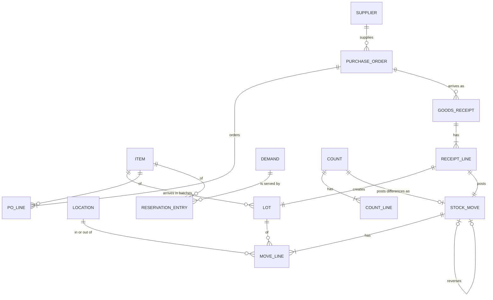

# Inventory and purchasing model (milestone 3): proposal for approval

Status: **proposal, waiting for the owner's answers** (2026-10-26). No code written yet.

Milestone 3 is done when **stock balances match a physical count** and **two people reserving the last stock at the same moment cannot both succeed**. This document proposes how stock, reservations, purchase orders and receiving are stored, in plain language, so that both hold by construction and every number can be traced back to what happened.

## The idea in one paragraph

Nothing in the stores is ever "typed over". Every time material or goods move (arrive, are issued, are counted, are corrected) the system writes one **stock movement** that is never changed again. What is in a store is simply the **sum of its movements**. Promises are kept the same way: every reservation and every release is one **reservation entry**, and what is reserved is their sum. So **available = on hand − reserved** is always a calculation, never a stored figure that can drift. A mistake is fixed with a new reversing movement and a reason, so the history always explains the number.

## The picture

## What each part holds

| Part | Holds | Example |
| --- | --- | --- |
| **Lot** | One batch of one item, with where it came from: a receipt line (virgin material, with the supplier's own batch number if there is one), an opening count, and later a production run (finished goods, milestone 4) or a recycling run (regrind, milestone 4). Numbered automatically. Lets the floor record "material loaded: lot …" and trace damage back to a batch. | LLDPE M500026, lot R-0012, 40 bags from PO-0007 |
| **Stock movement** | One event: its kind (receipt, issue, return, transfer, count adjustment, reversal; later production in, delivery out), who did it, when, why, what it refers to (a PO receipt, a count, a material request), and a client key so a screen that sends it twice stores it once. **Append-only.** | Receipt of 1,000 kg into the raw material store |
| **Movement line** | The quantity in or out of one store for one lot, signed (+ in, − out), always in the item's unit (kg for materials and regrind; pieces or kg for finished goods). A transfer has two lines that cancel out. **Append-only.** | Raw material store, lot R-0012, +1,000 kg |
| **On hand** | Not stored: the sum of movement lines per store, item and lot. | 1,000 kg |
| **Demand** | Something that needs stock: a production order (milestone 4) or a customer order line (milestone 6). Holds the item, the quantity needed and its **priority** (first come first served by default; an authorised person may move it up or down, with a reason). | Production order 12 needs 840 kg LLDPE |
| **Reservation entry** | Stock promised to a demand (+), released (−) or used up when issued (−). Per item and store, not per lot: the lot is chosen when the goods are actually issued. **Append-only.** | +840 kg LLDPE for production order 12 |
| **Reserved, available** | Not stored: reserved = sum of reservation entries; available = on hand − reserved. | 1,000 − 840 = 160 kg available |
| **Supplier** | Who material is bought from: name, phone, notes, active. No prices. | Supplier A |
| **Purchase order** | Number, supplier, status (draft, approved, partly received, received, cancelled), who created and approved it. No prices. | PO-0007, approved |
| **PO line** | Material, quantity (kg, also shown in bags), and its own **expected arrival date (ETA)**, which the purchaser can change (each change is audited). Received quantity is not typed: it is the sum of the receipts. | 1,000 kg LLDPE, ETA Hidar 12 |
| **Goods receipt** | One arrival against a PO: date, who received it, the supplier's delivery note number, and its lines (quantity in bags or kg, supplier batch number). Posting it creates the lots and the receipt movement, then re-runs allocation. | Delivery note 4471, 40 bags |
| **Count** | A physical count of one store: who counted, when, and per lot the counted quantity. The difference from the system is posted as one count-adjustment movement, with a reason. Crown's **opening stock** is simply the first count. | Raw material store count, 2 differences |

## The rules this model makes hold

- **Two sales cannot take the last stock.** Every change to an item's on-hand or reserved quantity (reserve, release, issue, receive, count) first **locks that item's row** in the database, then reads on-hand and reserved, then writes. A second request for the same item waits until the first has finished and then sees the new numbers, so it can never promise stock that is already promised. Items are always locked in the same order, so two requests touching several items cannot block each other forever. A test runs many reservations of the last stock **at the same time** against a real PostgreSQL and checks that the total promised never exceeds what is there.
- **Stock never goes below zero.** An issue or transfer that would make a store's lot negative is refused inside the same locked transaction. A count can bring a lot to zero, never below.
- **Arriving stock goes to who waited first.** When a receipt (or later, finished goods) is posted, allocation runs in the same transaction: waiting demands for that item, in priority order, are reserved as far as the new stock goes. Whether a demand may be served in part is the existing setting (reserve partial: on).
- **Append-only, with reasons.** Movements, movement lines, reservation entries, counts once posted and receipts once posted are never updated or deleted; the database refuses it (as it already does for the audit log and recipe versions). A correction is a reversing movement that points at the original and carries a reason.
- **Units never mix.** A quantity is always in its item's unit. Bags are a way of entering and showing kg (bags × the material's bag size); the stored figure is kg.
- **No prices.** Purchase orders and receipts hold quantities, dates and reference numbers only.
- **Every action has a name and a time.** Each movement records the user who entered it. Store screens may be used on a tablet, so movements carry a client key and a repeat send is stored once.

## Who does what

| Role | In milestone 3 |
| --- | --- |
| Purchaser | Suppliers; creates, edits and approves purchase orders; changes ETAs; records goods receipts |
| Store manager, raw material | Sees raw material and regrind stock; counts those stores (posts differences with a reason) |
| Store manager, finished goods | Sees finished goods stock; counts that store |
| Production manager, owner, finance | See all stock, purchase orders and expected arrivals (read only) |
| Administrator | As today; can see everything |

These become permissions as data (for example `inventory.read`, `inventory.count`, `purchasing.manage`), not role names in code.

## What milestone 3 delivers, and what waits

**Built and usable in milestone 3:** suppliers; purchase orders with ETAs and approval; the purchasing view of expected arrivals; receiving against a PO (creates lots and stock); stock per store, item and lot with on hand, reserved and available; the history of every movement for an item; reversals with a reason; counts (including the opening count).

**Built and tested now, used from milestone 4 on:** demands, the reservation engine with locking and allocation, and drafting a purchase order when a demand cannot be covered by stock plus open orders. Nothing creates a demand until production orders (milestone 4) and customer orders (milestone 6) exist, so in milestone 3 "reserved" is zero on screen. The engine's rules are tested directly, including the race test, so milestone 4 builds on proven code.

**Later:** issue to machines and returns (milestone 4, with material requests), finished goods in from staging (milestone 4), regrind in from recycling (milestone 4), deliveries out (milestone 6). Each is a new movement kind on the same ledger.

## Choices for the owner

| # | Question | My recommendation |
| --- | --- | --- |
| 1 | Lots: one lot per received line, numbered by the system, with the supplier's batch number as an optional extra? | Yes |
| 2 | Can virgin material be received **without** a purchase order? | No. Every arrival points at a PO; stock already in the store goes in through the opening count |
| 3 | If more arrives than was ordered? | Allow it after a confirmation; the receipt is marked "more than ordered" and audited |
| 4 | May the purchaser approve their own purchase orders? (`process.md`: the purchaser "edits and approves") | Yes. After approval, changing a quantity or adding a line needs a reason; ETA changes are audited without a reason |
| 5 | The order's expected arrival, shown on the PO and in the purchasing view | The latest ETA among lines not yet fully received (the day the order should be complete), with each line's own ETA shown too |
| 6 | Counting: should the counter see the system's quantity while counting? | No ("blind count"): they type what they see, then the differences are shown; posting them needs a reason. Posted by the store manager, no second approver for now; the owner can see every difference in the history |
| 7 | When material is issued (milestone 4), which lot goes first? | Oldest first (first in, first out) is suggested; the store manager may choose another lot |
| 8 | Manual holds: may someone reserve stock by hand, without an order? | No. Reservations only come from production orders and customer orders, so every promise has an owner and a reason |
| 9 | Suppliers as a short list (name, phone, notes)? | Yes |
| 10 | PO numbers: a simple running number (PO-0001, PO-0002 …)? | Yes; dates on it show in the Ethiopian calendar like everywhere else |

## Model choice and order of work

This design (locking, allocation, append-only ledger) is Opus work. After approval: Sonnet builds the backend in small PRs (ledger and stock view, then purchasing and receiving, then counts, then the reservation engine with the race test on Opus for review), each with integration tests on real PostgreSQL. Screens follow approved mockups: stock overview, item history, purchase orders, expected arrivals, receiving, counts.
