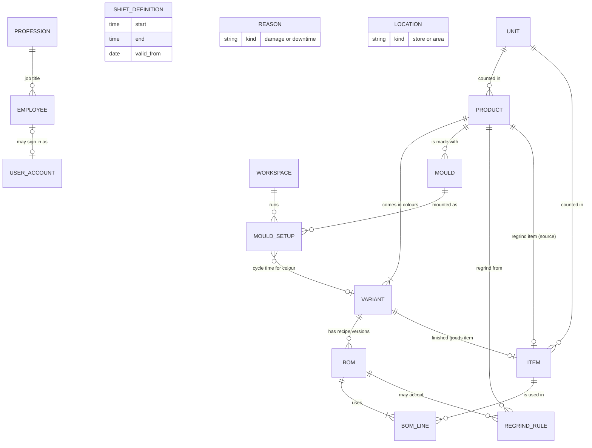

# Master data model (milestone 2): proposal for approval

Status: **approved by the owner on 2026-10-21.** Revised the same day after the owner's first answers (cycle time levels, versions only for BOMs, regrind as separate items). No code written yet.

Master data is the set of facts about what Crown makes, with what, on which machines, by whom and when. Later milestones (stock, production, reports) only point at it. This document proposes how to store those facts, in plain language.

## The picture

## What each part holds

| Part | Holds | Example |
| --- | --- | --- |
| **Unit** | The units quantities are counted in, with their kind (count or mass). Fixed list as data: piece, kg, g. | `kg` (mass) |
| **Product** | What Crown sells: name (English and Amharic), its **sale unit**, package size in that unit, weight per piece in grams (optional), active or not. | Jar cover: unit kg, bag of 25 kg, 8 g per piece |
| **Variant** | A colour of a product, in both languages. Production orders, stock and recipes are per variant. | Jar cover, clear |
| **Item** | Anything that has stock: each finished variant, each raw material grade, each additive or masterbatch, and **one regrind item per source product** (so regrind keeps its origin). | "LLDPE M500026", "Regrind from jar cover" |
| **BOM** (recipe) | For one variant: which items, how much per one sale unit, and its alert tolerances (default from the setting: 5% warning, 10% critical). **Versioned**: a change makes a new version with a reason. | Clear jar cap v2: 1.000 kg LLDPE per kg |
| **BOM line** | One ingredient: item, quantity per one sale unit of the product, unit. | 8 g LLDPE per egg tray piece |
| **Regrind rule** | On a BOM: regrind from **which source product** may be used, and an optional **maximum blend percentage** (empty = no cap). No rule = regrind not allowed. | Egg tray BOM: from egg tray, from jar cover, no cap |
| **Workspace** | A place where work happens: machines, the QC area, the recycling workspace. Name in both languages, kind, runs 24 hours or not. | Machine 2 |
| **Mould** | A mould: name or code, **number of cavities**, the product it makes. | Clear jar cap mould, 11 cavities |
| **Mould setup** | A mould on a machine: the **standard (default) cycle time** in seconds, optionally per colour. It is only the starting suggestion: each day's plan copies it and the planner may change it for that day or shift (see "Cycle time" below). Editable and audited. | Machine 2 + jar cap mould: standard 31.7 s |
| **Shift definition** | Each shift: name, start and end time (local), order. Editable and audited. Every event and plan records the shift it belongs to, so changing times later never moves past records. How many shifts there are follows from the active definitions. | Night: 18:00 to 08:00 |
| **Reason** | One editable list, each entry in both languages and carrying a **kind tag**: damage or downtime (more kinds can be added later, for example reasons for a plan change). The screen shows the kinds as tabs. Entries are retired, never deleted. | Damage: splitting. Downtime: power off |
| **Location** | The five stock and non-stock places, as data. | Regrind store |
| **Profession** | Job titles as data, in both languages. | Operator, QC inspector |
| **Employee** | A person who works at Crown: name, profession, active, and an **optional link to a user account**. Operators have no account for now; HR later links accounts to existing employees with their history intact. | An operator, no account |

Rotation teams, rosters and attendance are milestone 7 and are left out here.

## The rules this model makes hold

- **Units per product.** Every product has one sale unit (egg tray: piece; jar cover: kg). Stock, plans and BOM quantities are stored in the unit of their item or product. Pieces and kg are converted **only** through the product's weight per piece, and a converted figure is labelled as such. Quantities are exact decimals (three decimal places), never floating-point numbers.
- **Plans from cycle time.** The target in pieces comes from planned hours, the cycle time and the mould's cavities, as in Crown's weekly report. For a product sold in kg, the target is converted with the weight per piece.
- **Cycle time has three levels.** (1) The **standard** on the mould setup is the default that drafts a plan. (2) The **planned** cycle time is a copy inside that day's plan; the production manager or shift production manager (the planner for that day and shift) can change it, and a change to an approved plan needs a reason and is audited. (3) The **actual** cycle time is logged during the run. Changing the standard never changes a past plan, because each plan keeps its own copy. Later, the system can show the actual cycle times by machine, shift and planner as a recommendation for the standard; that is a report, not master data.
- **Jar cover regrind goes only into egg tray production.** This is not written in code. It holds because only the egg tray BOM has a regrind rule for "from jar cover", and no other BOM does. When material is loaded (milestone 4), the system rejects regrind that the variant's active BOM does not allow, and any blend above the rule's maximum. Changing it is a BOM change: new version, reason, audit row.
- **Editable settings stay settings.** Tolerance defaults, rest interval, alert levels and similar rules stay in the `settings` table (audited, with a screen for the administrator). A BOM may override the tolerance for its product.
- **Both languages.** Every name a person reads (product, colour, item, reason, workspace, profession, location) has an English and an Amharic value.
- **Single company now, clean for later.** No company column yet, and no table that mixes two companies' data, so one can be added.

## Append-only or editable

| Kind | What | How changes work |
| --- | --- | --- |
| **Append-only** | Audit log (already); **BOM versions** once activated, with their lines and regrind rules | Never updated or deleted. A change is a new version with a reason, because a past production run must keep the recipe it was run with (variance reports would otherwise change after the fact) |
| **Editable, audited** | Products, variants, items, workspaces, moulds, mould setups (standard cycle times), shift definitions, reasons, locations, professions, employees, settings | Updated in place; every change writes an audit row with who, when, old and new value. Past plans and events are safe because they store their own copy (cycle time) or reference (shift) |
| **Retired, never deleted** | Anything that history may point to: products, variants, items, reasons, workspaces, moulds, employees | Marked inactive. Hidden from new choices, still shown in old records |

Stock movements and floor events (milestones 3 and 4) are append-only too; they point at this master data.

## Choices, and where we stand with the owner

| # | Choice | Recommendation | Owner |
| --- | --- | --- | --- |
| 1 | A BOM per colour variant, created by copying another colour's BOM | Yes. Colours may need different masterbatch; copying keeps setup quick | Yes |
| 2 | Cycle time: standard on the mould setup, planned per day by the planner, actual logged | Yes (revised from "versioned by date" after the owner explained that cycle time depends on the machine, the shift, the manager and the planner) | Yes |
| 3 | One regrind item per source product ("Regrind from egg tray", "Regrind from jar cover") instead of one regrind item with a tag | Yes: separate stock lines keep counts exact per source and make the BOM rule simple to enforce | Yes |
| 4 | Versions only for BOMs; cycle times and shift times are editable and audited | Yes (revised: the owner said a configured recipe is used always, while cycle times change with the person) | Yes |
| 5 | Damage and downtime reasons in one list with a kind tag | Yes | Yes (a tag) |
| 6 | Professions as a data list, separate from sign-in roles | Yes | Yes |
| 7 | Weight per piece on the product (for example 8 g) | Yes | Yes |
