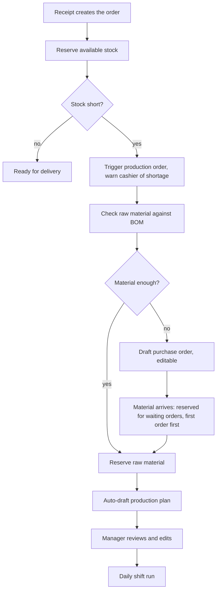

# Crown Manufacturing: Process Document

Source of truth for how the factory works. A change to a rule updates this file in the same commit.
Last updated: 2026-10-19.

## Purpose and scope

This system runs Crown's production chain end to end, from a customer receipt to finished goods in stock, and shows the whole factory floor live. It is a web application used by staff on any device with internet.

**In scope**
- Customer orders created from sales receipts, with reservation of finished goods
- Production orders, bills of materials (BOM), machine and shift planning
- Raw material reservation, purchase orders and receiving
- Daily material requests and issues, real-time machine logging, quality control (QC)
- Recycling of damaged output back into raw material
- Employees, shifts, work assignments and performance
- Finished goods staging and stock, deliveries, free samples, pay-later sales
- Reports for the owner and for finance, including paid-versus-delivered reconciliation

**Out of scope for now**
- Accounting, payroll, prices and invoicing. The system records quantities and receipt numbers only; finance keeps money in its own system.
- Full HR beyond roles, shifts and attendance for production staff. Planned later: HR employment management, where every employee has an account and can make requests (for example applying for leave). Until then production staff have no accounts and the shift production manager keeps their records.

**Design principle.** Every rule below is a default that authorized people can override, with a reason where noted and an audit log of who changed what. Business rules are settings, not fixed code, so new products, machines or rule changes need configuration rather than rebuilding.

## Products, workspaces and stock locations

Crown makes two products on two machines, plus a recycling workspace. Each is configured as data, so a third product or machine is added in settings.

| Product | Workspace | Counted and sold by | Packaging |
| --- | --- | --- | --- |
| Egg tray | Machine 1 (molding) | Piece | One package holds a fixed number of pieces (setting) |
| Jar cover (cap for large water jar) | Machine 2 | Kilogram | One bag holds a fixed kg (setting) |
| Damaged output | Recycling workspace | Kilogram | Becomes regrind |

**Raw material types**
- **Virgin material:** imported, bought through purchase orders.
- **Regrind:** produced by the recycling workspace from damaged output, with no loss. Regrind is a raw material like any other, and each product's BOM decides whether it may be used (see Recycling).

**Stock locations**

| Location | Holds | Notes |
| --- | --- | --- |
| Raw material store | Virgin material | Issued only after store manager approval |
| Regrind store | Regrind | Source product kept for traceability |
| QC area | Output waiting for inspection, split into finished and damaged | Not stock |
| Staging area | Inspected finished goods waiting for approval | Not stock; stock manager approves entry |
| Finished goods store | Approved finished goods | Available vs. reserved shown separately |

**Stock states.** Every item is *available*, *reserved* (promised to an order, still in the store) or *issued* (physically released). Sales only sees available stock.

## Roles and permissions

Each person has one or more roles; roles control what they can see and approve. Permissions are configurable, and the table is the proposed starting point.

| Role | Main responsibilities in the system |
| --- | --- |
| Cashier / sales (finance) | Issues receipts, which create orders; records pay-later and deliveries; sees available stock only |
| Production manager | Reviews and edits production plans (reason required); manages shifts and assignments; approves overrides |
| Shift production manager / supervisor | Requests daily raw material; updates machine and QC assignments; approves rest rotations; closes the shift report |
| Store manager (raw material) | Approves and issues raw material; weighs leftovers at handover |
| Store manager (finished goods) | Approves staging into stock; releases goods against a receipt, sample or pay-later record |
| Machine operator | *Not a sign-in role.* Operators have **no account**: they work the machine and are recorded as employees, and the shift production manager enters the logs (material loaded, machine on/off, output, downtime) for them |
| QC inspector | Has an account. Inspects output and records finished (pieces or kg) and damaged (kg with reasons) themselves, and is personally responsible for the output they inspected: every QC record carries their name |
| Purchaser | Edits and approves purchase orders; records receiving |
| Finance (report user) | Reads daily, weekly and monthly production and reconciliation reports |
| Owner / GM | Reads the live board, dashboards and all reports |
| Administrator | Creates and manages user accounts and roles; later also settings, products, BOMs, shifts and damage reasons |

**Sample approval** is a separate permission. The cashier creates sample requests and the store manager approves them as delivered when releasing the sample. Both are configurable.

One person can hold several roles, and every action is stored with the user, the time and the shift. Floor staff without an account (operators) are employees, not users: when a manager enters something on their behalf, the entry stores both the manager who typed it and the employee it is about.

**User accounts**
- Only an administrator creates accounts. People sign in with email and password; there is no self sign-up.
- Role names, their one-line descriptions and their permissions are data in the database (English and Amharic), not fixed in code. Roles for features that do not exist yet carry no permissions until their milestone adds them.
- The administrator sets a temporary password (typed or generated) and tells the person privately. The system shows a generated password once, right after it is set. A new account, and any password reset by an administrator, **must be changed at the person's first sign-in**; until then the API allows only changing the password.
- Deactivating a person (a separate button with a confirmation) stops them signing in and ends their open sessions at once; their records stay. Reactivating is a plain button. Email addresses cannot be changed after creation for now.
- The last active administrator cannot be deactivated or lose the administrator role; the API refuses, whatever the screen shows.
- Every role change, deactivation, reactivation, rename and password reset or change is written to the audit log with who did it, when, and the old and new value (never a password or hash). Sign-in successes and failures are logged too, and five failed attempts for an email pause sign-in for 15 minutes (a setting).

## Order-to-production chain

A customer receipt starts a chain that reserves stock, triggers production for any shortfall, and triggers a purchase if raw material is missing.

A short order is reserved in part and produced for the rest; a missing material triggers an editable purchase order, and arriving material is reserved for the waiting order automatically.

- The cashier never creates a production order for a customer order by hand. Manual production orders are only for filling the finished goods store.
- Reservation priority is first order first, and authorized users can reorder it.
- A stock-level shortage only raises an alert; a shortage caused by an order creates the draft purchase order.
- Every purchase order line carries an expected arrival date (ETA), which the purchaser can edit. The order's expected arrival is shown on the purchase order and in the purchasing view.
- After the production manager approves a plan, any change needs a reason and is logged.

## Daily shift operations

Every shift runs the same cycle, and every floor action is logged as it happens. The machines run 24 hours; the number of shifts (two or three) and each shift's start and end time are settings.

1. **Shift opens.** The incoming shift confirms the previous shift's handover report: leftover raw material, finished goods, damaged output and work-time. Leftovers are weighed; any difference from the report is recorded and flagged.
2. **Daily plan.** The system generates a plan per machine from the approved production plan, cycle times, inputs and outputs. The shift production manager can edit it.
3. **Material request.** The shift production manager requests the day's raw material. The default quantity is daily machine capacity multiplied by the BOM, minus leftovers carried over. The store manager approves and issues it. Material already reserved still needs this approval, so responsibility is traceable.
4. **Machine run.** The shift production manager (supervisor) logs, in real time and on behalf of the operators, who have no accounts: material loaded (kg, type, lot), machine on, output, downtime with a reason, machine off. Each entry names the operator it is about. Entries come from a tablet, phone or desktop.
5. **Quality control.** QC inspectors, who sign in with their own account, inspect every piece and record the results themselves. Finished output is counted in pieces (egg trays) or kg (jar covers). Damaged output is recorded in kg with general reasons from a list, not piece by piece.
6. **Staging and stock.** Finished output waits in the staging area until the finished goods store manager approves it into stock. Damaged output goes to the recycling workspace.
7. **Rest rotation.** After a set time (currently 1 hour), the system prompts that a machine operator should rotate to QC. The operator tells the supervisor, who updates the assignment. Every change is logged with a time.
8. **Shift closes.** The outgoing shift submits one handover report: raw material remaining (weighed), output, finished goods, damage, and each person's work time by workspace. The night shift's remaining raw material is used in the next day's request.

**Variance alerts.** The system flags material used that differs from the BOM beyond a set tolerance, machines idle too long, and unusually high damage rates.

## Recycling and input/output logic

Damaged output returns as regrind with no loss, so the system tracks two views of the same material and never counts one kilogram as new virgin input.

**Worked example.** A machine takes 100 kg of virgin material and produces 90 kg finished and 10 kg damaged. The 10 kg goes to the recycling workspace and comes back as 10 kg of regrind, which is loaded later into a product whose BOM allows it (at Crown today, egg trays).

| View | What it counts | Example result | Used for |
| --- | --- | --- | --- |
| Gross throughput | All material that passed through a machine, recycled kg counted again | 100 kg in the first run, then 10 kg again in the later run, so 110 kg | Machine and shift productivity |
| Net yield | Virgin material consumed against good output over time | 100 kg virgin for 100 kg good once the regrind is used | Cost per unit, material variance, true yield |

**Rules**
- Virgin and regrind are separate stock items with their own lots.
- Recycling is its own workspace record: damaged kg in, regrind kg out. With no loss the two match; any difference is flagged.
- Where regrind may go is set on each BOM, not fixed in the system. A BOM line says whether regrind is allowed, which regrind (by source product) and an optional maximum blend percentage. A run or material request that uses regrind on a BOM that does not allow it is rejected.
- Crown's starting setup: the egg tray BOM allows regrind from egg tray and jar cover damage; the jar cover BOM does not allow regrind. Changing this is a BOM edit, logged in the audit log.
- Every damaged kg keeps its reason list, shift, machine and operator, so waste can be traced to its source.
- Reports always state whether they show gross or net numbers.

## Sales, samples and finance reconciliation

Finance's paid quantity and the store's delivered quantity are tracked as separate numbers on every order line, so a partial delivery never looks like an unexplained release.

**Sale at the cashier**
- The cashier sees available stock only, not reserved stock.
- Issuing a receipt creates the order automatically.
- If stock covers the order, it is reserved for that customer. If stock is short, the available part is reserved, the cashier gets a shortage warning with an estimated ready date from the production plan, and production is triggered for the rest.
- The customer may pay the full amount. The shortfall then shows as *paid, not delivered*.

**Three quantities per order line**

| Quantity | Source | Meaning |
| --- | --- | --- |
| Ordered | Receipt | What the customer asked for |
| Paid | Finance receipt number | What finance has recorded as paid |
| Delivered | Store release | What the store has physically released |

**Deliveries.** Every store release must reference a receipt, a sample record or a pay-later record. A later delivery of a carried-over balance points back to the original receipt, so finance sees it as fulfilling an old payment, not an unpaid release.

**Free samples.** The cashier creates a sample request for a named customer and quantity (no limit for now). The customer goes to the store, the store manager finds the request, releases the sample and marks the request delivered. A sample is its own movement type with no receipt. If the customer later orders, the order links to the sample so conversion can be measured.

**Pay-later.** Customers who take goods before paying are recorded as delivered, not paid, and appear on a receivables list for finance. The rules are kept simple for now: the cashier can record it, with no credit limits or blocking for now; these can be added later.

**Reconciliation report (daily, weekly, monthly, for finance)**
- Paid, not yet delivered (with receipt numbers and the period they came from)
- Delivered, not yet paid
- Samples released
- Delivered quantity compared with production output and finished goods stock movement

## Employees, shifts and assignments

The system records who works when and where, so performance can be measured per person, workspace and shift.

- **Employee record:** name, profession (operator, QC inspector, supervisor and others), and, for people who sign in, a link to their account. Operators have no account for now.
- **Shift pattern:** two or three shifts (a setting), each with its own start and end time, with weekly rotation (for example day one week, night the next). Rotation rules are configurable per employee or team.
- **Weekly roster:** the production manager sets the team for each shift. The system can propose the next week from the rotation rule.
- **Workspace assignment:** the supervisor records where each person starts and every move afterward (machine 1, machine 2, QC, recycling), each with a time.
- **Rest rotation:** after the configured time on a machine (currently 1 hour), the system suggests who should move to QC. The employee tells the supervisor, who confirms or changes the assignment in the system.
- **Attendance:** the supervisor or production manager records arrival and departure. For now one manager marks each person as logged in; a fingerprint system is planned for later.
- **Performance (derived automatically from the logs):** output per hour per machine and per person, damage rate, downtime by reason, hours worked per workspace, and material variance.

## Live board, alerts and reports

The owner can open one screen and see what is happening now, what happened so far, and who is where, without cameras. Every floor action is a timestamped event (who, which workspace, what, how much), and all screens and reports are built from those events.

**Live board**
- Per workspace: status (running, idle, down), current order, material loaded, output so far, damage so far, assigned staff.
- Per shift: plan against actual, handover status.
- Orders: reserved, waiting for production, waiting for material, waiting for purchase, ready, delivered.
- Stock: raw material, regrind, staging, finished goods (available and reserved).

**History.** Any shift or order can be replayed as a timeline of events.

**Alerts**
- Finished goods or raw material below the configured level (alert only, no automatic purchase).
- Machine idle or down beyond a set time.
- Material used outside BOM tolerance, or a high damage rate.
- Rest rotation due.
- Handover difference between reported and weighed material.

**Reports**

| Report | Audience | Contents |
| --- | --- | --- |
| Shift handover | Shift managers | Material, output, finished, damage, work time |
| Daily, weekly, monthly production | Owner, finance | Output by product, gross and net yield, damage by reason |
| Reconciliation | Finance | Paid vs. delivered vs. produced, samples, receivables |
| Performance | Owner, production manager | Per machine, shift and person |
| Purchasing | Purchaser, owner | Open purchase orders with expected arrival dates, arrivals, shortages |

**Offline use.** Data entry screens should save entries when the connection or power drops and sync when it returns, and power cuts are logged as a downtime reason.

## Configurable settings and flexibility

Adding a product or changing a rule should be a settings change. The system is built around generic concepts (product, BOM, workspace, production order, event), and these settings control behavior.

| Setting | Current value or default |
| --- | --- |
| Reserve partial stock and produce only the shortfall | On |
| Reservation priority | First order first, editable by authorized users |
| Shortage on an order | Draft purchase order, editable; stock-level shortage is an alert only |
| Plan changes after approval | Production manager, reason required |
| Daily material request default | Daily capacity × BOM minus leftovers |
| Rest rotation interval | 1 hour |
| Shift rotation | Weekly rotation across the configured shifts (two or three, each with start and end time) |
| Package size | Egg tray: fixed pieces per package; jar cover: fixed kg per bag |
| Unit of measure per product | Egg tray: piece; jar cover: kg |
| Regrind rules | Per BOM: regrind allowed or not, which source products, optional maximum blend percentage. Crown: egg tray allows, jar cover does not |
| BOM variance tolerance | Alert at ±5% per product, critical at ±10% |
| Damage reason list | Editable list |
| Sample approval | Cashier requests, store manager approves as delivered; no limit |
| Pay-later | Allowed; cashier can record it; no limits for now |
| Data entry | By the shift production manager (supervisor) on behalf of operators, on any device. Operators do not have accounts |

For a new product, an administrator defines the product, unit, package size, BOM (with color variants), workspace, cycle time and QC reasons. Nothing in the flow is specific to egg trays or jar covers.

**Calendar.** Dates show in the Ethiopian calendar by default, including its 13 months, with the Gregorian calendar available as an option. Dates are stored exactly either way, so reports and shift times never depend on the display choice.

**Language.** The interface is available in English and Amharic from the start, and each user can switch at any time. Translations are reviewed by an Amharic speaker at Crown before rollout.

**Hosting.** The system runs on one cloud server and is reached over the internet. Crown's internet is normal, so offline entry on floor screens is a safety net for short drops, not the main way of working.

## What Crown's weekly report shows

The current report (night shift, clear jar caps, one week) already lists the numbers the system will capture live, so the system can fill every row automatically and remove the manual totals. Most rows map directly:

| Report row | Where the system gets it |
| --- | --- |
| Produced item + color | Product and color variant on the production order |
| Cycle time (sec), cavity count | Machine and mould settings, with actual cycle time logged per run |
| Production target (pcs) | Calculated: planned hours × 3,600 ÷ cycle time × cavities |
| Actual production, achievement % | Finished output from QC; the percentage is calculated |
| Planned production hours | Shift plan |
| Downtime (min) and reason | Downtime log with start, stop and a reason from a list |
| Rejected pcs, rejection rate, reasons | QC damage records with reasons |
| Material type, consumption (kg, bags) | Raw material issued minus returned, by lot |
| Weekly totals | Generated automatically |

**What the numbers tell us**
- **Target formula confirmed.** 14 hours (50,400 s) ÷ cycle time × 11 cavities gives the target for Tuesday to Saturday. Monday's target is 22 pieces off the formula.
- **Typed totals contain errors.** Monday's achievement shows 85.5%, but 15,000 ÷ 17,747 is 84.5%. Dates are typed inconsistently (one as text, six with day and month swapped) and stray numbers sit outside the table. A calculated report avoids this.
- **"Actual production" means good pieces.** The rejection rate only works out as rejected ÷ (actual + rejected): Monday 2,342 ÷ 17,342 = 13.5%.
- **Material use is steady at about 8 g per piece**, rejects included (7.9 to 8.1 g across the six days). That is a good default BOM value, and a ±5% tolerance (7.6 to 8.4 g) would not raise alerts on a normal day.
- **Raw material comes in 25 kg bags** (138 kg is shown as 5.5 bags).
- **Power cuts are the biggest loss.** All 360 minutes of downtime in the week were "Power off" (Monday 90, Thursday 60, Saturday 210). At each day's cycle time that is roughly 7,500 pieces, about 70% of the 10,369-piece gap to target (105,762 planned, 95,393 produced, 90.2%). This is an estimate; the system will report it exactly.
- **Rejection reasons are three general ones:** raw material spill from the mould, splitting, and colour defect. They become the starting damage reason list.

Jar covers will be recorded in kg, a unit set when the product is created, with an editable weight per piece (about 8 g) so reports can also show pieces.

## Decisions, open questions and next steps

All earlier open points and the questions from the weekly report are decided; two items remain.

| Topic | Decision |
| --- | --- |
| Material compatibility | Egg tray and jar cover material is compatible, so jar cover regrind can go into egg trays. Whether a product may use regrind is set on its BOM (Crown: egg tray yes, jar cover no). No maximum regrind percentage given yet; the setting stays empty (no cap) until Crown confirms one. |
| Free samples | The cashier creates a request, the store manager releases the sample and marks it delivered. No limit for now; roles stay configurable. |
| Pay-later | The cashier can record it. No limit for now; to be revisited if the business needs it. |
| Who creates orders | Only the finance cashier, through the receipt. No portal or other sales role for now. |
| Attendance | One manager marks each person as logged in. A fingerprint system is planned for later. |
| BOM variance alert | Default alert at ±5% per product and critical at ±10%, to be tuned after real data. |
| Owner's first screen | A dashboard in this order: machine status, today's output, damage rate, pending orders, who is working where, plus alerts. It will be improved over time. |
| Shifts | Machines run 24 hours. The number of shifts (two or three) and each shift's start and end time are configurable. |
| Unit of measure | Jar covers are counted in kg; the unit is chosen when each product is created, so any product can use pieces or kg. |
| Colors | Color is a variant set on the product and its BOM (for example clear jar caps). The color list is entered by Crown when known. |
| Calendar | Ethiopian calendar by default; Gregorian available as an option. |
| Weekly report | Generated automatically by the system for the owner, replacing the manual report the owner reads today. |

**Still open**

- [ ] Day shift report and egg tray report: not available now; share them when you can so the screens match Crown's current forms.
- [ ] Maximum regrind percentage per mix, if Crown has one.

**Next steps**

1. Review this document and correct anything that does not match the factory.
2. Share the other reports and forms when you have them (day shift, egg tray, finance receipt and weekly report, store forms).
3. Write the implementation plan: phases, data model and screens.
4. Design mockups for approval.
5. Build.
